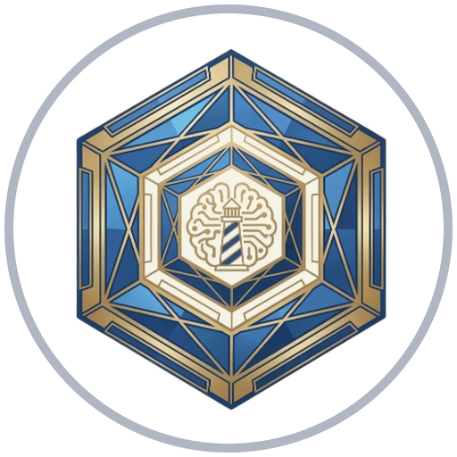
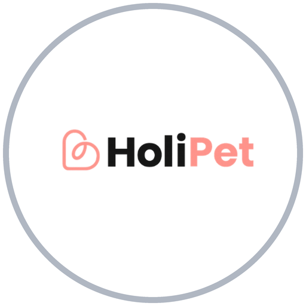

# Hi, I'm Soph

**I build AI tools for developers.**

I work across product and engineering: I define problems, design systems, direct AI-assisted implementation, review the code, and test outcomes.

## What I'm building

### xkg

**xkg connects human knowledge to the work AI agents do.**

The goal is to give agents the relevant, verified knowledge for the task at hand—with sources, connections, and a history of what changed. You own the knowledge in your GitHub repo and choose the AI provider.

Capture and MCP access are available today. The knowledge graph and verification features are in development.

[Try it](https://xkg.xmu.sh) · [Code](https://github.com/xmu-labs/xkg) · [Get started](https://github.com/xmu-labs/xkg#get-started) · [Connect your tools](https://github.com/xmu-labs/xkg/blob/main/docs/connect.md)

### xmu — in development

**xmu standardizes and governs how humans and AI agents work together.**

The goal is shared engineering work across the agents, tools, models, and workflows teams already use. People and agents can collaborate on the same task, follow progress, redirect the work, and hand it off—with common rules for permissions, spending, and review.

### HoliPet

An AI assistant that helps people care for their pets.

I founded and built HoliPet. Forbes Centroamérica mentioned it and quoted me in an article about pet care businesses in Latin America.

[Demo](https://app.holipet.io/demo) · [Forbes article](https://forbescentroamerica.com/2025/07/17/pettech-una-industria-que-crece-y-representa-nuevas-oportunidades-de-negocio-en-latinoamerica/)

### Focus companion — early exploration

A personal iPhone app concept for starting tasks, staying in flow, and building a routine that adapts to how I work with ADHD. Currently in product design and planning; no app is available yet.

## How I work

I start with the hardest assumption. I test it against a simpler approach before building more around it.

I use AI agents to build, review, and test software. I make design tradeoffs explicit and require evidence that the system does what it claims.

I believe technology should adapt to your workflow, not the other way around. I build tools with that in mind: you own the workflow, your data stays yours, and you choose the AI models.

## Get in touch

[LinkedIn](https://linkedin.com/in/sofia-padron-valdez) · [Email](mailto:sofia@spvtechnology.com)

I speak Spanish, English, and French.
